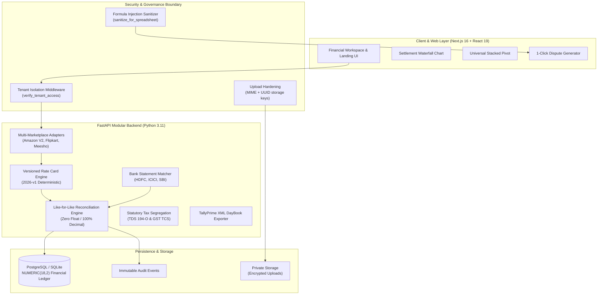

# SellerFlow AI

> **Accountant-Grade Financial Intelligence & Multi-Marketplace Reconciliation for Indian E-Commerce**  
> *"Know what you earned. Verify what reached your bank. Track every deduction. Find every unexplained difference."*

[](https://github.com/techmuthal-cloud/SaaS/actions/workflows/ci.yml)
[](LICENSE)
[](https://python.org)
[](https://nextjs.org)

---

## 1. System Architecture



---

## 2. Core Repository Structure

```
sellerflow-ai/
├── apps/
│   ├── api/                  # FastAPI backend service
│   │   ├── app/
│   │   │   ├── core/         # Config, Database, Logging, Security
│   │   │   ├── models/       # SQLAlchemy models (Tenants, Ledger, Rate Cards, Bank)
│   │   │   ├── routes/       # Tenant-scoped API endpoints
│   │   │   └── services/     # Ingestion, Rate Cards, Reconciliation, Bank, Tax
│   │   └── migrations/       # Alembic database migrations
│   └── web/                  # Next.js 16 frontend application
│       └── src/app/          # Landing page, financial dashboard, evidence drawers
├── packages/
│   └── shared/               # Shared TypeScript types & financial contracts
├── infra/                    # Dockerfile.api, Dockerfile.web, Nginx configurations
├── docs/
│   ├── specs/                # 22 Modular system specifications (PRD, TRD, DB, API)
│   ├── FINANCIAL_DOMAIN_MODEL.md  # Core financial calculation invariants
│   └── ENGINEERING_STANDARDS.md   # Security baseline and review policies
├── tests/
│   ├── unit/                 # Rate cards, adapters, and decimal math tests
│   ├── integration/          # Bank matching, statutory taxes, and smoke tests
│   ├── security/             # Cross-tenant isolation & formula injection tests
│   └── fixtures/             # Real anonymized Amazon, Flipkart, Meesho reports
├── docker-compose.yml        # Multi-container orchestration (API, Web, DB, Redis)
├── .env.example              # Canonical environment configuration
└── .github/
    ├── workflows/ci.yml      # Automated GitHub Actions validation pipeline
    └── pull_request_template.md # PR financial & security review checklist
```

---

## 3. Financial Invariants & Correctness Guarantees

1. **Zero Float Arithmetic**: All calculations strictly use `decimal.Decimal` in Python and `NUMERIC(18,2)` in SQL.
2. **Like-for-Like Fee Audit**: Rate card rules calculate the expected fee for an order based on category, price, and weight slab. Expected fees are compared strictly with actual marketplace fee deductions.
3. **No False Overcharges**: Normal contracted marketplace deductions are never flagged as overcharges.
4. **Deposit-First Bank Matching**: Marketplace settlement disbursements are verified against real bank credits before breaking down deductions.
5. **Tax Segregation**: Section 194-O TDS (1%) and Section 52 GST TCS (1%) are isolated into distinct tax buckets.
6. **Formula Injection Sanitization**: All CSV and Excel downloads escape leading `=`, `+`, `-`, `@`, `\t`, and `\r` characters with single quotes (`'`) to protect users opening files in Microsoft Excel.

---

## 4. Quickstart: Local Development

### Prerequisites
- Python 3.11+
- Node.js 20+
- Git

### 1. Backend Setup
```bash
# Clone the repository
git clone https://github.com/techmuthal-cloud/SaaS.git
cd SaaS

# Set up environment variables
cp .env.example .env

# Set up Python environment
cd apps/api
python -m venv .venv
source .venv/bin/activate  # On Windows: .venv\Scripts\Activate.ps1
pip install -r requirements.txt

# Seed development/staging database
python ../../scripts/seed_staging.py

# Start the API server
uvicorn app.main:app --host 0.0.0.0 --port 8000 --reload
```
API Documentation will be live at `http://localhost:8000/docs`.

### 2. Frontend Setup
```bash
# In a new terminal window
cd apps/web
npm install
npm run dev
```
Web application will be live at `http://localhost:3000`.

---

## 5. Running Automated Tests

Run the complete test suite (unit, integration, and security):

```bash
# From repository root
export PYTHONPATH=apps/api   # On Windows: $env:PYTHONPATH="apps/api"
python -m pytest tests/ -v
```

### Test Coverage Highlights:
- **`tests/unit/test_reconciliation_math.py`**: Validates rate card fee calculations, like-for-like fee audit, rounding tolerances, and refund attribution.
- **`tests/unit/test_marketplace_adapters.py`**: Validates Amazon V2, Flipkart, and Meesho header normalization and non-zero amount extraction.
- **`tests/security/test_security_and_tenant_isolation.py`**: Enforces cross-tenant denial (HTTP 403), file upload path traversal neutralization, and formula injection escaping.
- **`tests/integration/test_bank_and_tax_reconciliation.py`**: Validates bank statement parsing, settlement-to-bank matching, and statutory tax calculations.

---

## 6. Docker Deployment

Launch the complete stack (PostgreSQL, Redis, API, and Next.js Frontend) with a single command:

```bash
docker-compose up --build -d
```

- Web UI: `http://localhost:3000`
- API & Docs: `http://localhost:8000/docs`
- Healthcheck: `http://localhost:8000/api/v1/health`

---

## 7. Production Deployment Strategy

- **Frontend**: Deploy on [Vercel](https://vercel.com) connecting to the GitHub repo with `Root Directory: apps/web` and `NEXT_PUBLIC_API_URL=https://api.yourdomain.com`.
- **API & Workers**: Deploy via Docker on [Railway](https://railway.app), [Render](https://render.com), or [Fly.io].
- **Database**: Managed PostgreSQL on [Supabase](https://supabase.com) or AWS RDS.
- **Object Storage**: AWS S3 or Cloudflare R2 for encrypted, tenant-isolated report uploads.

---

## 8. License

Licensed under the [MIT License](LICENSE).
