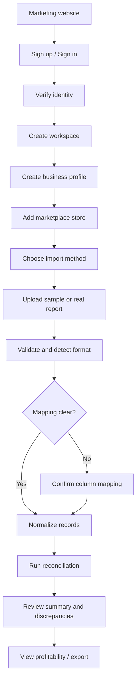
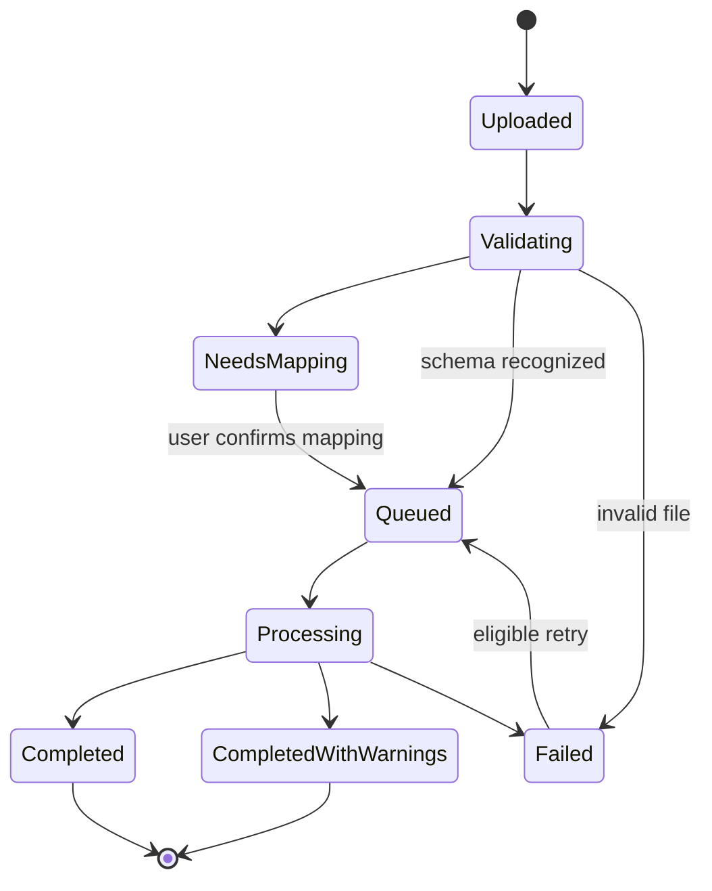
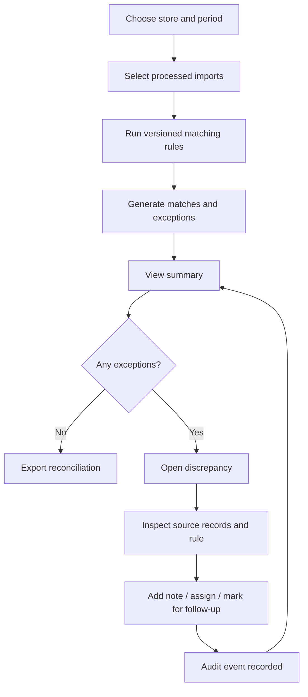

# Application Flows

## 1. First-time user flow

## 2. Upload/import state flow

## 3. Reconciliation review flow

## 4. Role-dependent flows

- Viewer: dashboard, reports and permitted transaction details only.
- Analyst: upload, map, process and review reconciliation.
- Accountant: assigned client/business scope and financial exports.
- Admin: workspace and member management.
- Owner: all workspace features including billing and security settings.

## 5. Error and recovery flows

- Invalid file: show reason and allowed file requirements; no processing job.
- Unknown schema: route to mapping review; do not guess silently.
- Partial data: show missing source type and partial result label.
- Worker failure: preserve job and import state; retry only if idempotent.
- Ambiguous match: open review queue.
- Expired integration token: request reconnect; stop automatic sync.
- Export failure: keep export request with safe error code and retry option.

## 6. User notification events

- Import completed.
- Import completed with warnings.
- Import failed.
- Mapping needs confirmation.
- Reconciliation run completed.
- New discrepancy requires review.
- Export ready or failed.
- Integration needs reconnect.

Notifications must not expose sensitive transaction details in email subject lines or push previews.
