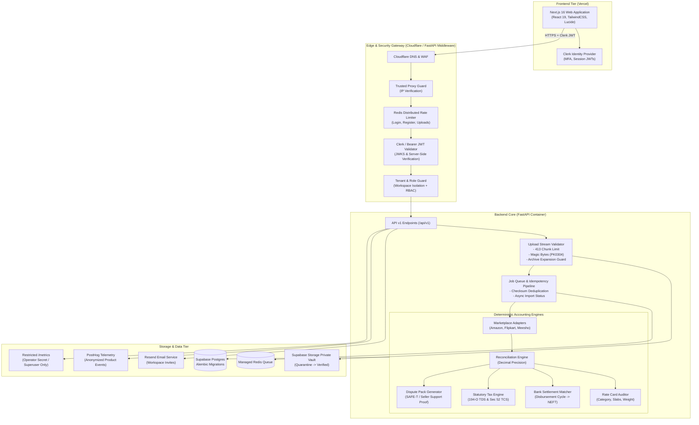

# SellerFlow AI — Production Technical Architecture & System Design

**Version:** 3.0 (Production-Grade & Anti-Fabrication Hardened)  
**System Target:** Enterprise Multi-Tenant E-Commerce Financial Reconciliation Platform  

---

## 1. Executive Architecture Summary

SellerFlow AI is engineered according to **strict financial domain discipline**:
1. **Deterministic Arithmetic Only:** Zero floating-point operations. All financial calculations use Python `decimal.Decimal` and PostgreSQL `NUMERIC(18, 2)`.
2. **AI Never Mutates Ledger State:** LLMs are strictly confined to generating dispute cover letters and human-readable explanations. AI is forbidden from computing or modifying fees.
3. **Zero Financial Fabrication:** If financial or discrepancy records do not exist, the API returns explicit zero-state summaries or 404 errors. Hardcoded demo values and synthetic estimates are prohibited in production code paths.
4. **Defense-in-Depth Multi-Tenancy:** Authentication, workspace membership, and Role-Based Access Control (RBAC) are verified on the server for every single API request.

---

## 2. Recommended Production Cloud Stack

| Layer | Recommended Vendor / Platform | Implementation & Security Responsibility |
|---|---|---|
| **Frontend** | **Vercel** | Hosts Next.js 16 App Router UI. No financial secrets, service keys, or calculation logic. |
| **Authentication** | **Clerk** | Manages user sign-up, sign-in, session tokens, and MFA. FastAPI verifies Clerk tokens server-side and provisions internal tenant records. |
| **Backend API** | **FastAPI on Container Host** (Render / Fly.io / ECS) | Validates tokens, enforces workspace RBAC, validates uploads, and orchestrates financial engines. |
| **Database** | **Supabase Managed Postgres** | System of record. Managed relational schemas, row-level constraints, least-privilege roles, and automated PITR backups. |
| **Schema Migrations** | **Alembic** | Single source of schema truth. Startup `create_all()` is disabled in production; migrations run as a mandatory release step. |
| **File Storage** | **Supabase Storage** | Private object vault (`sellerflow-vault`). Enforces quarantine prefixes, short-lived signed URLs, and automatic purge on validation failure. |
| **Distributed Rate Limiting & Jobs** | **Upstash Redis / Managed Redis** | Distributed sliding-window rate limiting and durable queue state across container instances. |
| **Transactional Email** | **Resend** | Delivers workspace invitations and completion notifications. Never emails bank numbers, PAN/GSTIN, or financial transaction rows. |
| **Product Telemetry** | **PostHog** | Tracks coarse operational events (`upload_completed`, `reconciliation_run`). Strictly filtered to strip financial numbers and order IDs. |
| **DNS & Edge** | **Cloudflare DNS & WAF** | Manages domain routing, TLS termination, and DDoS protection. Configured as trusted reverse proxy. |

---

## 3. High-Level Architecture Diagram

---

## 4. Role-Based Access Control (RBAC) Matrix

Every workspace endpoint enforces tenant membership and permissions:

| Operation | Path | Allowed Roles | Denied Roles |
|---|---|---|---|
| **View Reports & Dashboard** | `GET /workspaces/{id}/*` | `owner`, `admin`, `accountant`, `member`, `viewer` | Unauthenticated, Non-members |
| **Upload Settlement & Bank Files** | `POST /workspaces/{id}/imports` | `owner`, `admin`, `accountant` | `viewer`, `member` |
| **Execute Reconciliation Run** | `POST /workspaces/{id}/reconcile` | `owner`, `admin`, `accountant` | `viewer`, `member` |
| **Export Dispute Packages** | `GET /workspaces/{id}/disputes/*` | `owner`, `admin`, `accountant`, `member` | Non-members |
| **Configure Rate Cards** | `POST /workspaces/{id}/rate-cards` | `owner`, `admin` | `accountant`, `member`, `viewer` |
| **Workspace Settings & Invites** | `POST /workspaces/{id}/members` | `owner`, `admin` | `accountant`, `member`, `viewer` |
| **System Operator Telemetry** | `GET /api/v1/metrics` | `is_superuser=True` OR `X-Monitoring-Token` | All regular tenants & users |

---

## 5. Anti-Fabrication Integrity Guarantees

In financial reconciliation, presenting estimated or invented numbers undermines seller trust and legal compliance:
1. **Tax Reconciliation (`/tax-reconciliation`):**
   * When a workspace has no sales records, the API returns a deterministic summary with `gross_sales: "0.00"`, `tds_section_194_o: "0.00"`, and `status: "no_transactions"`.
   * **Never** substitutes synthetic baseline revenue.
2. **Dispute Claim Package (`/disputes/generate`):**
   * If an order discrepancy does not exist in the database, the API returns `404 Not Found`.
   * **Never** invents claims, placeholder SKUs, or synthetic weight overcharges.
3. **Cross-Tenant Store Rejection:**
   * Passing a `store_id` that does not belong to the authorized workspace immediately returns `400 Bad Request`.
4. **Idempotent Duplicate Protection:**
   * If an identical report (matching SHA-256 hash) has already completed in the workspace, the system returns the existing verified import record without duplicate ledger entries.

---

## 6. Pre-Production Release Gate Checklist

Before onboarding real seller financial data in staging or production, the following release gates must be satisfied:

- [x] **Clerk Token Verification:** Verified Bearer tokens with server-side identity validation; forged headers (`X-User-ID`) rejected.
- [x] **Tenant & Role Boundaries:** All 46 automated integration and security tests pass.
- [x] **Anti-Fabrication Verification:** Endpoints return exact ledger zeros or 404s when records are missing.
- [x] **Upload Hardening:** Streaming 413 limits, magic byte validation (`PK\x03\x04`), archive expansion limits (100MB max, 20 sheets max), and formula injection escaping.
- [x] **Operator Telemetry Protection:** `/metrics` rejects regular users and requires non-placeholder monitoring secrets or superuser credentials.
- [x] **Trusted Proxy Configuration:** Client IPs extracted from `X-Forwarded-For` only when direct caller is in `TRUSTED_PROXIES`.
- [x] **Alembic Schema Pipeline:** Explicit reviewed migrations for Supabase Postgres; automatic startup table creation disabled in production.
- [x] **Zero-Leakage Telemetry & Email:** PostHog and Resend sanitize all payloads to exclude order IDs, bank numbers, and financial transaction amounts.
