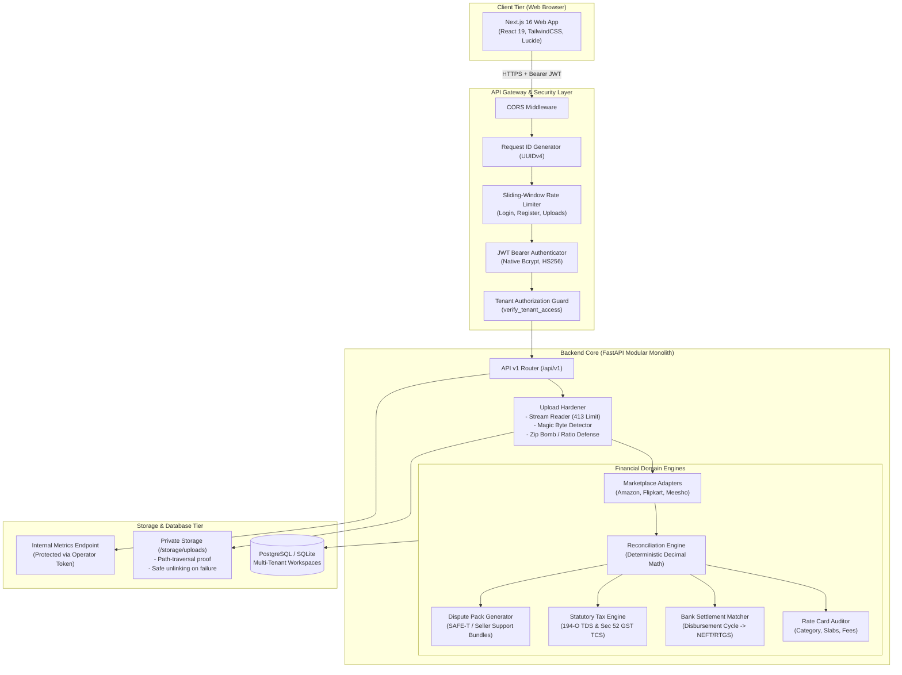
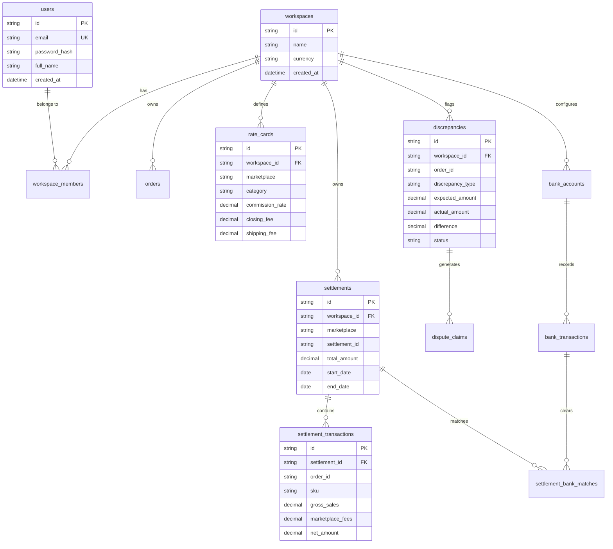

# SellerFlow AI — Technical Architecture & System Design

**Version:** 2.0 (Production Hardened)  
**Target Environment:** Multi-Tenant E-Commerce Financial Reconciliation SaaS  

---

## 1. High-Level System Architecture

SellerFlow AI is engineered as a **domain-driven, multi-tenant modular SaaS platform** combining a Next.js front-end with a hardened FastAPI financial processing backend, PostgreSQL as the system of record, and deterministic arithmetic calculation engines.



---

## 2. Component Breakdown

### A. Client Tier (`apps/web`)
* **Framework:** Next.js 16 (App Router), React 19, TypeScript.
* **Styling & Components:** TailwindCSS v4, Lucide React icons, Glassmorphic FinTech UI design.
* **Key User Journeys:**
  * Interactive Landing Page & Margin Simulator (`app/page.tsx`).
  * Settlement-Period-First Upload Workflow (Amazon, Flipkart, Meesho, and Bank CSVs/XLSX).
  * Discrepancy Breakdown & Real-Time Fee Overcharge Detection.
  * Instant Dispute Claim Package Exporter (CSV + PDF/Text Cover Letters).

### B. Security & Identity Infrastructure (`apps/api/app/core/`)
* **Strict Tenant Isolation:** Every request to `/api/v1/workspaces/{workspace_id}/*` validates the user's membership against `workspace_members`. Cross-tenant requests return `403 Forbidden`.
* **Zero Client Identity Forgery:** All identity verification is strictly derived from verified Bearer JWT tokens (`sub` claim). All legacy bypasses (e.g. `X-User-ID`) are completely removed.
* **Startup Secret Validation:** On application boot, `validate_jwt_secret()` verifies that `JWT_SECRET_KEY` is supplied, at least 32 characters long, and not a known placeholder (e.g. `your-secret-key-change-in-production`).
* **Sliding-Window Rate Limiting:** In-memory sliding window rate limiter protects brute-force targets:
  * `/auth/login`: 10 requests / min.
  * `/auth/register`: 5 requests / min.
  * `/reports/upload` & `/bank-statements/upload`: 15 requests / min.
* **Operational Monitoring Security:**
  * Liveness probe `/health` returns `{ "status": "alive" }`.
  * Readiness probe `/health/ready` executes a live `SELECT 1` against the database; returns `503 Service Unavailable` on connection failure.
  * Internal telemetry `/metrics` is strictly guarded behind `X-Monitoring-Token` or operator Bearer tokens.

### C. Upload & File Protection Hardening (`apps/api/app/core/security.py`)
* **Stream-Based Size Limits (`read_upload_stream_safely`):** Files are streamed in 64KB chunks. If accumulated size exceeds `MAX_FILE_SIZE_MB` (25MB), the connection is aborted immediately with `413 Request Entity Too Large` before loading into memory.
* **Magic-Byte Content Inspection (`validate_and_sanitize_upload`):**
  * `.xlsx`: Must start with ZIP header `PK\x03\x04` and pass decompression safety checks.
  * `.csv` / `.txt`: Rejects any binary payload containing null bytes (`\x00`).
* **Zip Bomb & Archive Expansion Defenses:**
  * Maximum sheets limit (`MAX_XLSX_SHEETS = 20`).
  * Maximum uncompressed size limit (`MAX_XLSX_UNCOMPRESSED_MB = 100MB`).
  * Compression ratio check: Any archive file exceeding a 100:1 compression ratio is aborted immediately.
  * Row limit guard: Files exceeding 50,000 rows are rejected to prevent worker thread starvation.
* **Path-Traversal & Formula Injection Defense:**
  * Filenames are sanitized via `os.path.basename` and generated UUID prefixes.
  * CSV export cells starting with `=`, `+`, `-`, `@`, `\t`, or `\r` are prepended with `'` to prevent spreadsheet formula execution exploits.
* **Fail-Safe Cleanup (`safe_cleanup_file`):** Disk storage files are safely unlinked in `finally` and `except` blocks if validation or parsing fails.

---

## 3. Financial Reconciliation Engine Architecture

The financial domain model strictly adheres to **deterministic accounting principles**:

```
                       ┌─────────────────────────┐
                       │  Marketplace Settlement │
                       │    (Disbursement ID)    │
                       └────────────┬────────────┘
                                    │
                                    ▼
                       ┌─────────────────────────┐
                       │  Canonical Normalizer   │
                       │  (Universal Fee Schema) │
                       └────────────┬────────────┘
                                    │
           ┌────────────────────────┼────────────────────────┐
           ▼                        ▼                        ▼
┌─────────────────────┐  ┌─────────────────────┐  ┌─────────────────────┐
│  Rate Card Auditor  │  │  Bank Match Engine  │  │ Statutory Tax (TDS) │
│ - Expected Comm     │  │ - NEFT / RTGS Match │  │ - Sec 194-O (1%)    │
│ - Expected Shipping │  │ - Settlement Total  │  │ - Sec 52 TCS (1%)   │
│ - Slabs & Weight    │  │   == Bank Deposit   │  │ - 26AS Reconciliation│
└──────────┬──────────┘  └──────────┬──────────┘  └──────────┬──────────┘
           │                        │                        │
           └────────────────────────┼────────────────────────┘
                                    ▼
                       ┌─────────────────────────┐
                       │   Discrepancy Ledger    │
                       │ - short_paid            │
                       │ - over_paid             │
                       │ - missing               │
                       │ - matched (<= +/- ₹1.00)│
                       └────────────┬────────────┘
                                    │
                                    ▼
                       ┌─────────────────────────┐
                       │  Dispute Claim Package  │
                       │  - Summary Cover Letter │
                       │  - Itemized CSV Proof   │
                       └─────────────────────────┘
```

### Financial Rules Enforced:
1. **Zero Floating Point Arithmetic:** All fee calculations, differences, and statutory taxes use Python `decimal.Decimal` and SQL `NUMERIC(18, 2)`.
2. **AI Never Mutates Ledger Values:** AI models assist only with natural language explanations and dispute ticket drafting; calculation logic is purely deterministic code.
3. **Like-for-Like Fee Audits:** Commission, Shipping (FBA/EasyShip/Self-Ship), and Pick & Pack fees are audited against contractual rate cards based on category, item selling price band, and weight slab.
4. **Tolerance Boundaries:** Deviations within +/- ₹1.00 are classified as `matched` to avoid chasing minute rounding artifacts.

---

## 4. Multi-Tenant Database Schema



---

## 5. Automated Testing & Verification Suite

The repository enforces automated validation across three test tiers:
1. **Unit Tests (`tests/unit/`):**
   * Deterministic fee calculations and rate card boundary tolerances.
   * Multi-marketplace adapter parsing (Amazon CSV/TXT, Flipkart Settlement CSV, Meesho Payment Sheet).
   * True overcharge vs normal marketplace fee deduction tests.
2. **Integration Tests (`tests/integration/`):**
   * Bank statement CSV parsing and NEFT settlement matching.
   * Statutory tax withholdings (Section 194-O TDS & Section 52 GST TCS).
   * Authenticated workspace creation, membership scoping, and API smoke tests.
3. **Security & Tenant Isolation Tests (`tests/security/`):**
   * Unauthenticated request rejections (401).
   * Forged header bypass attempts (`X-User-ID`).
   * Cross-tenant access attempts between independent workspaces (403).
   * Weak/placeholder JWT secret startup failure assertions.
   * File upload attack vectors: oversized files (413), mismatched extensions, null bytes in CSV, corrupt zip/XLSX.
   * Export formula injection escaping.
   * In-memory sliding-window rate limiting bursts (429).
   * Database readiness failure reporting (503).
